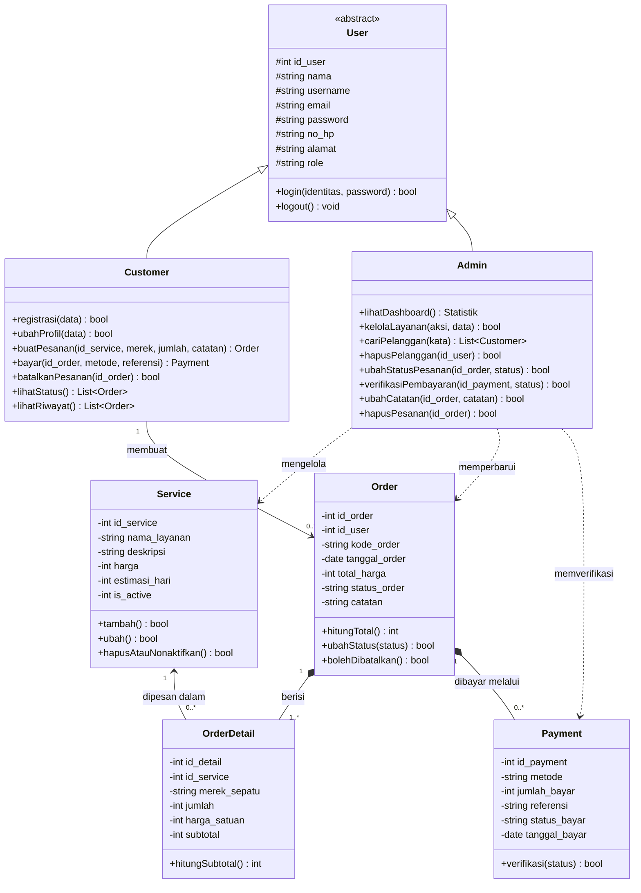

# Class Diagram ROALSHOES

Class Diagram berikut sesuai dengan struktur data (`config/data.js`) dan fungsi JavaScript di `auth.js`, `order.js`, dan `admin.js`. Method adalah nama fungsi yang berperan sama di kode.

## Keterangan

| Simbol | Arti |
|---|---|
| `+` / `-` / `#` | Public / private / protected |
| `<|--` | Pewarisan: Customer dan Admin adalah jenis User |
| `*--` | Komposisi: item dan pembayaran tidak ada tanpa pesanan |
| `-->` | Asosiasi dengan multiplicity |
| `..>` | Ketergantungan (admin menggunakan atau mengubah objek tersebut) |

## Pemetaan ke Kode

| Class | Implementasi |
|---|---|
| User, Customer, Admin | Satu tabel `users` dengan kolom `role`. Dua kelas dipakai untuk memisahkan perilaku di UML |
| Service | `rs_services`, fungsi di `admin.js` (`initLayanan`) |
| Order, OrderDetail, Payment | `rs_orders` (`details[]`, `payments[]`), fungsi di `order.js` dan `admin.js` |
| `login`, `registrasi` | `auth.js` |
| `buatPesanan`, `bayar`, `batalkanPesanan` | `initPemesanan`, `initStatus` di `order.js` |
| `ubahStatusPesanan`, `verifikasiPembayaran` | `initPesanan`, `ubahPembayaran` di `admin.js` |