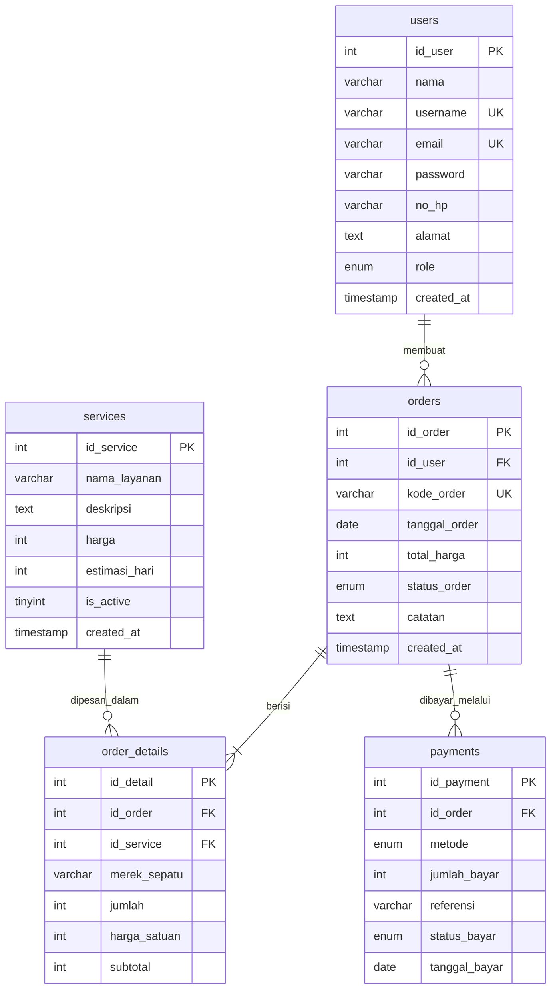

# ERD ROALSHOES

Sesuai `database/database.sql` (database `roalshoes_db`, 5 tabel). Peran pelanggan dan admin dibedakan oleh kolom `role` pada `users`.

## Diagram

## Relasi dan Kardinalitas

| Relasi | Kardinalitas | Penjelasan | Aturan hapus |
|---|---|---|---|
| users - orders | 1 ke 0..N | Satu pengguna dapat membuat banyak pesanan. Satu pesanan milik satu pengguna | RESTRICT |
| orders - order_details | 1 ke 1..N | Satu pesanan berisi minimal satu item | CASCADE |
| services - order_details | 1 ke 0..N | Satu layanan dapat muncul di banyak item pesanan | RESTRICT |
| orders - payments | 1 ke 0..N | Satu pesanan dapat memiliki beberapa catatan pembayaran (mis. pembayaran ditolak lalu dicatat ulang) | CASCADE |

## Kamus Data

| Tabel | Kolom penting | Keterangan |
|---|---|---|
| users | `role` | `pelanggan` atau `admin` |
| services | `is_active` | 1 aktif, 0 nonaktif (tampil di katalog hanya jika 1) |
| orders | `status_order` | Pending, Dikonfirmasi, Menunggu Sepatu, Sedang Dikerjakan, Quality Control, Selesai, Diambil/Dikirim, Dibatalkan |
| order_details | `harga_satuan` | Snapshot harga saat pesanan dibuat. `subtotal = harga_satuan x jumlah` |
| payments | `status_bayar` | Menunggu Verifikasi, Lunas, Ditolak |

## Pemetaan LocalStorage

| Kunci LocalStorage | Tabel SQL |
|---|---|
| `rs_users` | `users` |
| `rs_services` | `services` |
| `rs_orders` | `orders`, dengan `details[]` mewakili `order_details` dan `payments[]` mewakili `payments` |

Item pesanan di LocalStorage juga menyimpan `nama_layanan` agar tampilan lebih mudah. Di SQL, nama diambil lewat JOIN ke `services`.