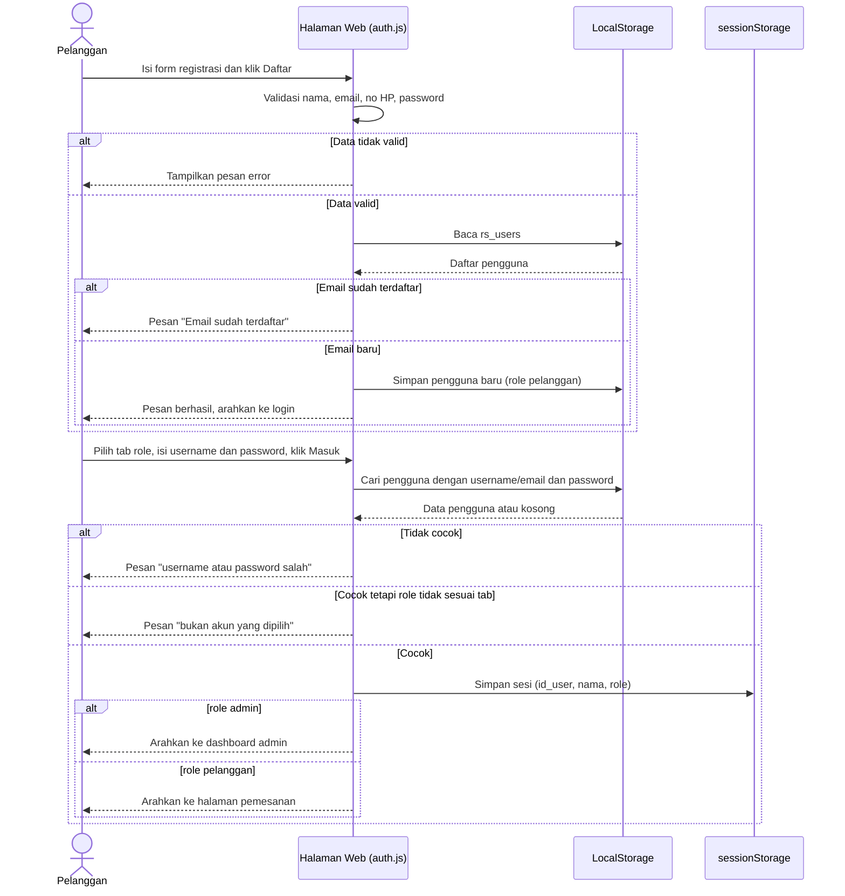
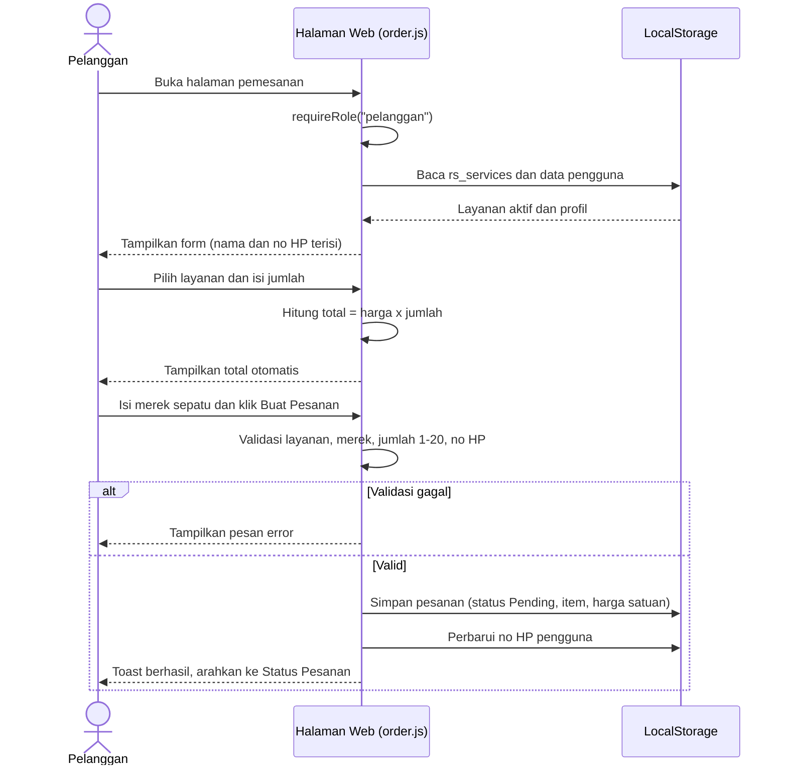
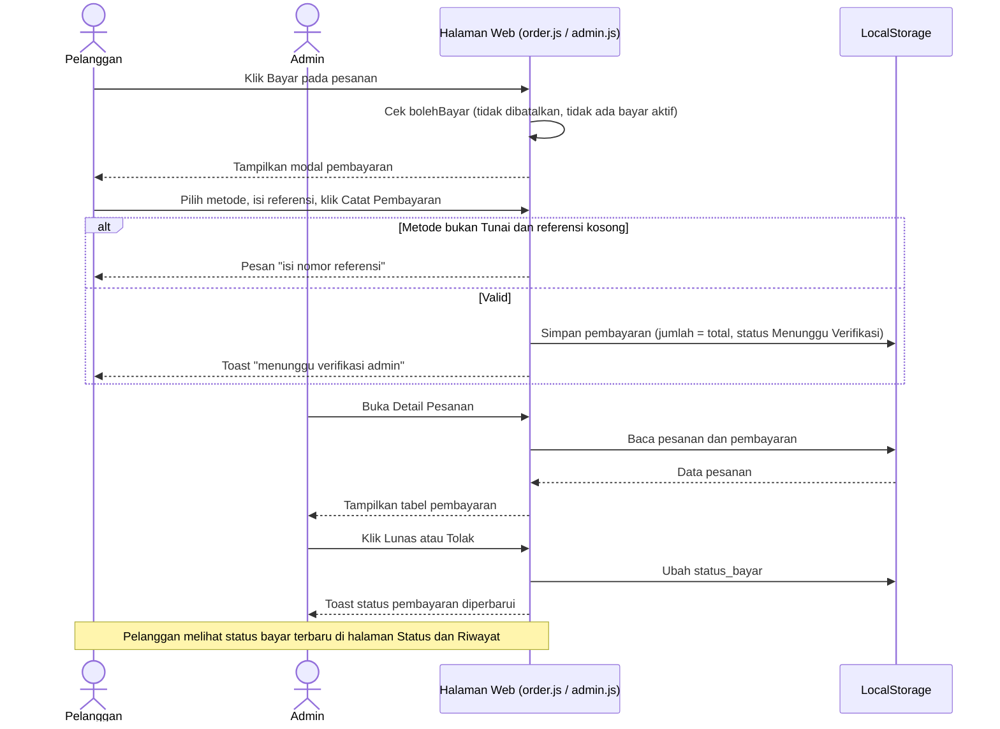
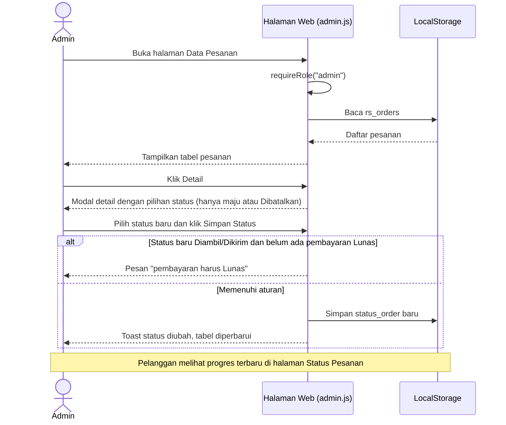

# Sequence Diagram ROALSHOES

Partisipan: **Halaman Web** (HTML dan JavaScript di browser), **LocalStorage** (penyimpan data simulasi, setara database), dan **sessionStorage** (sesi login). Karena tidak ada backend, validasi dan logika dijalankan oleh JavaScript.

## A. Registrasi dan Login

Registrasi memvalidasi input dan memastikan email unik sebelum menyimpan. Login memeriksa kecocokan data dan role pada tab, lalu membuat sesi dan mengarahkan sesuai role.

## B. Pemesanan Jasa Cuci Sepatu

Total dihitung langsung di browser. Pesanan disimpan dengan status awal `Pending` dan harga satuan sebagai snapshot.

## C. Proses Pembayaran dan Verifikasi

Pembayaran hanya dapat dicatat bila tidak ada pembayaran yang menunggu verifikasi atau sudah lunas. Jika ditolak, pelanggan dapat mencatat ulang.

## D. Pembaruan Status Pesanan oleh Admin

Pilihan status dibatasi oleh fungsi `opsiStatus()`, sehingga status tidak bisa mundur. Aturan BR-11 diperiksa sebelum menyimpan.

## Pemetaan ke API Rancangan

| Proses | Endpoint rancangan (`API-Documentation.md`) |
|---|---|
| A. Registrasi, login | `POST /auth/register`, `POST /auth/login` |
| B. Pemesanan | `GET /services`, `POST /orders` |
| C. Pembayaran, verifikasi | `POST /payments`, `PATCH /payments/:id/status` |
| D. Ubah status | `GET /orders`, `PATCH /orders/:id/status` |

Saat backend dibuat, "LocalStorage" digantikan database MySQL dan logika validasi pindah ke server.