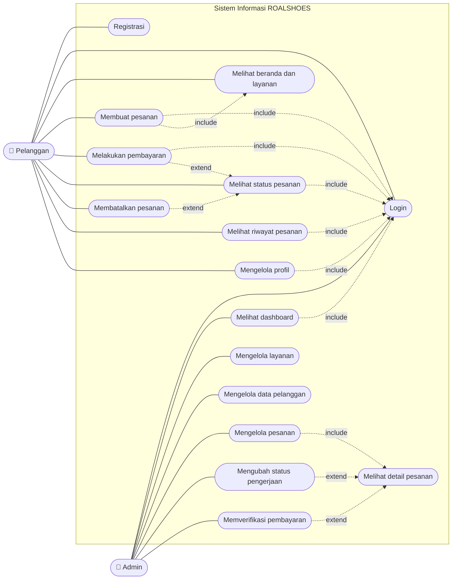

# Use Case Diagram ROALSHOES

Aktor: **Pelanggan** dan **Admin**.

> Catatan: Mermaid tidak punya notasi use case bawaan. Garis putus-putus berlabel menggantikan panah `<<include>>` dan `<<extend>>`. Arah panah `include` menuju use case yang disertakan. Arah `extend` menuju use case dasarnya.

## Deskripsi Use Case

| ID | Use case | Aktor | Deskripsi singkat |
|---|---|---|---|
| UC1 | Registrasi | Pelanggan | Mengisi nama, email, no. HP, dan password. Akun tersimpan sebagai role pelanggan |
| UC2 | Login | Pelanggan, Admin | Memilih tab role, mengisi username/email dan password. Sesi dibuat |
| UC3 | Melihat beranda dan layanan | Pelanggan | Melihat informasi usaha, layanan aktif, dan harga |
| UC4 | Membuat pesanan | Pelanggan | Memilih layanan, mengisi sepatu dan jumlah. Total otomatis, status Pending |
| UC5 | Melakukan pembayaran | Pelanggan | Mencatat metode dan referensi. Status Menunggu Verifikasi |
| UC6 | Melihat status pesanan | Pelanggan | Melihat progres dan info pembayaran |
| UC7 | Membatalkan pesanan | Pelanggan | Hanya saat status Pending atau Dikonfirmasi |
| UC8 | Melihat riwayat pesanan | Pelanggan | Tabel seluruh pesanan milik sendiri |
| UC9 | Mengelola profil | Pelanggan | Mengubah nama, no. HP, alamat, password |
| UC10 | Melihat dashboard | Admin | Statistik otomatis dan 5 pesanan terbaru |
| UC11 | Mengelola layanan | Admin | Tambah, ubah, hapus, atur harga dan status aktif |
| UC12 | Mengelola data pelanggan | Admin | Cari, lihat detail, hapus (jika belum punya pesanan) |
| UC13 | Mengelola pesanan | Admin | Cari, filter, ubah catatan, hapus pesanan |
| UC14 | Mengubah status pengerjaan | Admin | Memajukan status sesuai alur dan aturan bisnis |
| UC15 | Memverifikasi pembayaran | Admin | Mengubah Menunggu Verifikasi menjadi Lunas atau Ditolak |
| UC16 | Melihat detail pesanan | Admin | Item, pembayaran, status, dan catatan dalam satu tampilan |

## Hak Akses

| Use case | Pelanggan | Admin |
|---|---|---|
| Registrasi, membuat pesanan, membayar, riwayat, profil | Ya | Tidak |
| Login | Ya | Ya |
| Dashboard, kelola layanan, pelanggan, pesanan | Tidak | Ya |

Pembatasan ini diterapkan oleh fungsi `requireRole()` di `script.js`.